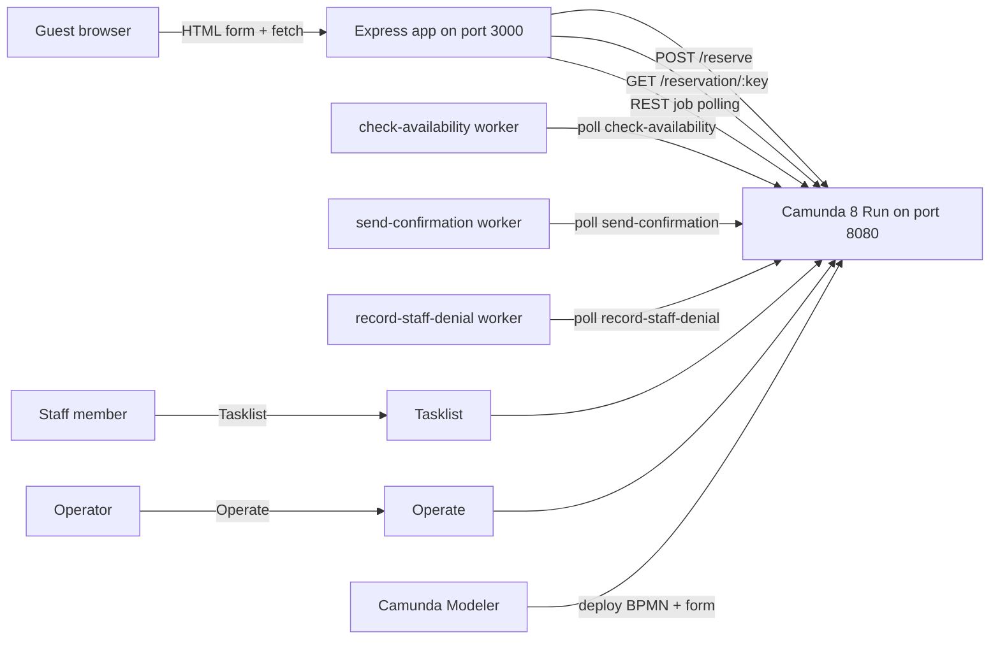
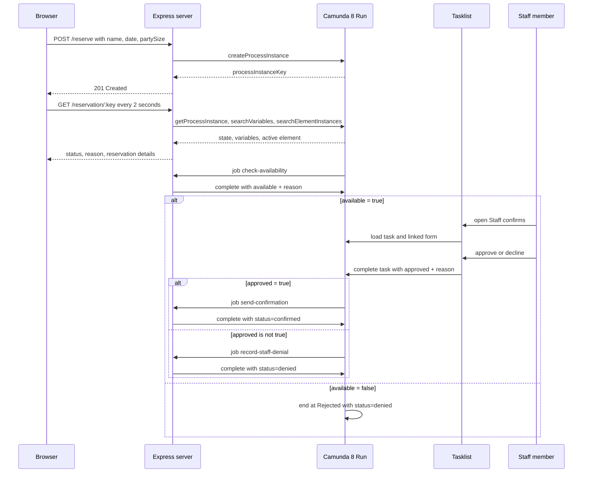
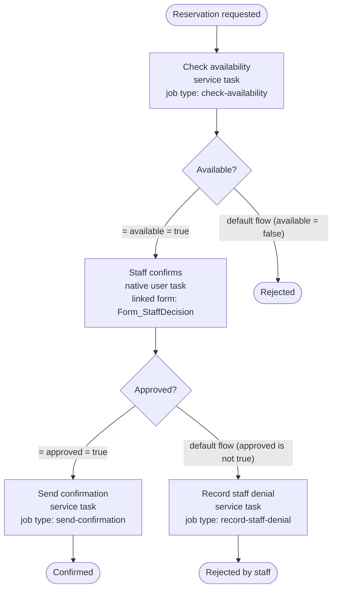

# Camunda 8 Reservation Demo

A small, local, beginner-friendly Camunda 8 project. A guest requests a table in a
plain HTML form. The request becomes a Camunda process instance. A job worker
checks availability, a staff member approves or declines the request in Tasklist,
and the browser follows the result live.

There is no application database, no login for the demo web page, and no frontend
framework. The only state is stored in Camunda process variables.

> **Important about timeouts:** the current `reservation.bpmn` has **no timer
> boundary event** and no timeout path. A reservation that reaches the staff task
> stays in `awaiting-staff` until a human completes it. This is documented
> truthfully in [Test Scenarios](#9-test-scenarios) and
> [Development Log](#13-development-log).

---

## Table of Contents

- [1. What This Project Is](#1-what-this-project-is)
- [2. Architecture](#2-architecture)
- [3. Prerequisites](#3-prerequisites)
- [4. Get the Project](#4-get-the-project)
- [5. Start Camunda 8 Run](#5-start-camunda-8-run)
- [6. Deploy from Camunda Modeler](#6-deploy-from-camunda-modeler)
- [7. Run the Demo](#7-run-the-demo)
- [8. Walk Through the Demo](#8-walk-through-the-demo)
- [9. Test Scenarios](#9-test-scenarios)
- [10. API Reference](#10-api-reference)
- [11. Code Walkthrough](#11-code-walkthrough)
- [12. Camunda Concepts](#12-camunda-concepts)
- [13. Development Log](#13-development-log)
- [14. Troubleshooting](#14-troubleshooting)
- [15. Security and Secrets](#15-security-and-secrets)
- [16. Limitations and Next Steps](#16-limitations-and-next-steps)
- [17. Clean Shutdown](#17-clean-shutdown)
- [18. Glossary](#18-glossary)
- [19. References](#19-references)
- [Appendix A. File Tree](#appendix-a-file-tree)
- [Appendix B. BPMN IDs](#appendix-b-bpmn-ids)
- [Appendix C. Variables and Environment](#appendix-c-variables-and-environment)
- [Appendix D. Log Reference](#appendix-d-log-reference)
- [Appendix E. Screenshots](#appendix-e-screenshots)
- [Appendix F. Copy-Paste Checklist](#appendix-f-copy-paste-checklist)

---

## Quick Start

If you already have Node.js, Camunda 8 Run, and the project folder, this is the
short version.

**Terminal 1 - start Camunda 8 Run:**

```powershell
cd C:\Camunda\c8run
.\c8run.exe start
```

Wait until Operate opens, or open <http://localhost:8080/operate>.

**Terminal 2 - start the demo:**

```powershell
cd $env:USERPROFILE\Desktop\reservation-demo
npm install
npm start
```

Open <http://localhost:3000>.

If you are starting from a fresh Windows PC, follow the full guide below.

---

## 1. What This Project Is

This is a learning demo for Camunda 8. It shows the complete loop:

1. A browser form collects `name`, `date`, and `partySize`.
2. `POST /reserve` starts a Camunda process instance with those three variables.
3. The `check-availability` worker accepts parties of 10 or fewer and rejects
   larger parties.
4. Accepted requests wait at a native Camunda user task called **Staff confirms**.
5. A staff member opens the task in Tasklist, sees a linked Camunda Form, and
   either approves or declines.
6. The process either runs `send-confirmation` or `record-staff-denial`.
7. The browser polls `GET /reservation/:key` every 2 seconds and shows the current
   status, a timeline, and the final result.

### What it demonstrates

- Deploying a BPMN process and a linked Camunda Form from Node.js.
- Starting a process instance through the Camunda Orchestration Cluster REST API.
- Three REST job workers: `check-availability`, `send-confirmation`, and
  `record-staff-denial`.
- Two exclusive gateways with FEEL conditions.
- A native Camunda user task with a linked Camunda Form.
- Deriving a customer-friendly status from process state, variables, and active
  elements.
- A simple polling frontend with no build step.

### What it deliberately does not do

- It does not use a database. Reservation data lives in Camunda process variables.
- It does not send real email. `send-confirmation` logs a message and sets
  variables.
- It does not implement authentication for the web page.
- It does not implement a timeout or timer boundary event.
- It is not production-ready. Camunda 8 Run itself is a local development tool.

### At a glance

| Item | Value |
| --- | --- |
| Web app | <http://localhost:3000> |
| Camunda REST API | <http://localhost:8080/v2> |
| Operate | <http://localhost:8080/operate> |
| Tasklist | <http://localhost:8080/tasklist> |
| Modeler deployment endpoint | `http://localhost:26500` (gRPC, no auth) |
| BPMN process id | `reservation` |
| Form id | `Form_StaffDecision` |
| Worker job types | `check-availability`, `send-confirmation`, `record-staff-denial` |
| Status values | `pending-availability`, `awaiting-staff`, `confirmed`, `denied` |

---

## 2. Architecture

### Components



The Express app and all three job workers run in the **same Node.js process**.
Camunda 8 Run runs separately.

### How a reservation flows



### Process flowchart



There is no timer boundary event in this diagram and no timeout branch.

### Where the state lives

| State | Stored in |
| --- | --- |
| Reservation details | Camunda process variables `name`, `date`, `partySize` |
| Availability result | Process variables `available`, `reason`, and sometimes `status` |
| Staff decision | Process variables `approved`, `reason` |
| Final result | Process variables `status`, `reason` |
| Browser progress | Derived from the process instance state and active element |

The demo server keeps no database. If you stop Camunda 8 Run and delete its local
data, the reservations are gone.

---

## 3. Prerequisites

You need Windows 10 or Windows 11 and PowerShell. The commands in this guide are
PowerShell commands.

### Version matrix

| Software | Version used by this project | Notes |
| --- | --- | --- |
| Camunda 8 Run | 8.10.8 | Local Camunda runtime |
| Camunda Modeler | 5.39.0 or newer | The BPMN and form were exported with 5.39.0 |
| Node.js | 20 or newer | `package.json` requires `>=20`; 22 or 24 LTS is recommended |
| npm | Comes with Node.js | Used to install dependencies |
| `@camunda8/orchestration-cluster-api` | `^10.0.1` | Installed by `npm install` |
| `express` | `^5.3.0` | Installed by `npm install` |
| OpenCode | Optional | Used to explore or edit the project with an AI coding agent |

You do **not** need Docker, a separate Java installation, a database, or a Camunda
account for this local demo.

### Install Node.js

Download the Node.js LTS installer from <https://nodejs.org/en/download> and run
it. Accept the defaults.

Or use `winget` in PowerShell:

```powershell
winget install OpenJS.NodeJS.LTS
```

Close and reopen PowerShell after installing, then verify:

```powershell
node --version
npm --version
```

`node --version` must print `v20` or newer.

### Install Git

Git is useful for version control but is not required to run the demo. Download it
from <https://git-scm.com/download/win>, or use:

```powershell
winget install Git.Git
```

Verify:

```powershell
git --version
```

### Install Visual Studio Code

VS Code is a comfortable editor for the BPMN, form, JavaScript, and README files.
Download it from <https://code.visualstudio.com/Download>, or use:

```powershell
winget install Microsoft.VisualStudioCode
```

### Install Camunda Modeler

Download Camunda Modeler from <https://camunda.com/download/modeler/> and install
it. The project files were exported with Modeler 5.39.0, so a newer 5.x version is
fine.

You only need Modeler if you want to edit the process visually or deploy from the
Modeler UI. The Node.js app can deploy the BPMN and form without Modeler.

### Install Camunda 8 Run 8.10.8

Download the Windows x86_64 archive directly:

<https://downloads.camunda.cloud/release/camunda/c8run/8.10.8/camunda8-run-8.10.8-windows-x86_64.zip>

The download is about 883 MB. The download folder is:

<https://downloads.camunda.cloud/release/camunda/c8run/8.10.8/>

Extract the zip to a short path such as `C:\Camunda`. Open the extracted folder
that contains `c8run.exe`. In this guide that folder is called
`C:\Camunda\c8run`; replace it with your real path if different.

**You do not need to install Java.** Camunda 8 Run includes a bundled Java runtime.
Camunda 8 Run also includes its own local storage, so you do not need to install a
database for this demo.

> Camunda 8 Run is intended for local development and prototyping. Do not use it
> for production.

### Optional: install OpenCode

OpenCode is an AI coding agent that can read this repository and help you edit it.
Install the CLI with npm:

```powershell
npm install -g @opencode/cli
```

Then authenticate:

```powershell
opencode auth login
```

If your OpenCode version uses the newer provider flow, start `opencode` and run
`/connect` instead; `/connect` is the current in-app provider login. After
connecting, run `/models` to choose a model.

Start OpenCode inside the project:

```powershell
cd $env:USERPROFILE\Desktop\reservation-demo
opencode
```

Useful OpenCode modes:

| Mode | What it does | When to use it |
| --- | --- | --- |
| **Build** | Default coding agent. Can read and edit files and run commands. | Implementing changes |
| **Plan** | Explores and plans without editing normal project files. Shell commands remain permission-controlled. | Understanding the code before changing it |

Switch modes with the agent switcher in the OpenCode interface. Use **Plan** to ask
questions such as "explain how `deriveReservationStatus` works", then switch to
**Build** when you are ready to make changes.

Install the VS Code extension:

1. Open VS Code.
2. Open the Extensions view.
3. Search for **OpenCode**.
4. Click **Install**.
5. Open the integrated terminal and run `opencode`.

VS Code shortcuts from the OpenCode docs:

| Shortcut | Action |
| --- | --- |
| `Ctrl+Esc` | Open OpenCode in a split terminal or focus an existing session |
| `Ctrl+Shift+Esc` | Start a new OpenCode session |
| `Alt+Ctrl+K` | Insert a file reference |

---

## 4. Get the Project

If you already have the folder, skip to installing dependencies.

The project should be at:

```text
C:\Users\<your-name>\Desktop\reservation-demo
```

If you received it as a zip, extract it there. If it is in a Git repository, clone
it and replace `<repository-url>` with the real URL:

```powershell
cd $env:USERPROFILE\Desktop
git clone <repository-url> reservation-demo
cd reservation-demo
```

Install the Node.js dependencies:

```powershell
cd $env:USERPROFILE\Desktop\reservation-demo
npm install
```

This creates `node_modules/` and installs:

- `@camunda8/orchestration-cluster-api`
- `express`

`package-lock.json` records the exact dependency tree and should stay in the
repository.

You do **not** need to create a `.env` file. The app works without one. The
`.gitignore` file excludes `.env` files so real secrets are not committed later.

Check the installed packages:

```powershell
npm ls --depth=0
```

Expected output includes the two dependencies and no missing packages.

---

## 5. Start Camunda 8 Run

Camunda 8 Run must be running before the demo server starts. The demo server fails
fast with a clear error if it cannot reach Camunda.

### 5.1 Start the runtime

Open **PowerShell** and go to the folder that contains `c8run.exe`:

```powershell
cd C:\Camunda\c8run
.\c8run.exe start
```

Wait for startup to finish. Camunda 8 Run usually opens Operate automatically. If
it does not, open:

- Operate: <http://localhost:8080/operate>
- Tasklist: <http://localhost:8080/tasklist>

Log in with the local default demo account. For Camunda 8 Run 8.10.8, the default
username and password are both `demo`. This is a public local-development default,
not a secret API credential.

### 5.2 Verify the REST API

The demo server talks to the REST API at `http://localhost:8080/v2`, not to the
gRPC endpoint. Verify it in a second PowerShell window:

```powershell
Invoke-RestMethod http://localhost:8080/v2/topology | ConvertTo-Json -Depth 5
```

You should receive a JSON topology response. If this fails, wait a little longer
and try again. Camunda can take some time to start on the first run.

### 5.3 Ports used by Camunda 8 Run

| Port | Purpose |
| --- | --- |
| `8080` | Camunda core, Operate, Tasklist, and the REST API |
| `8080/v2` | Orchestration Cluster REST API used by this app |
| `26500` | gRPC gateway used by Camunda Modeler for deployment |
| `8086` | Connectors API, not used by this demo |
| `9600` | Prometheus metrics, not used by this demo |

The demo web app uses port `3000`, so it does not conflict with Camunda.

### 5.4 Stop Camunda 8 Run

When you are finished, stop it from the same folder:

```powershell
cd C:\Camunda\c8run
.\c8run.exe stop
```

If startup fails, stop it, then start it again. This is the standard recovery step
from the Camunda documentation.

---

## 6. Deploy from Camunda Modeler

The recommended path is to let `npm start` or `npm run deploy` deploy both
`reservation.bpmn` and `staff-decision.form`. That guarantees the form is deployed
with the BPMN.

You can also deploy from Camunda Modeler. This is useful when you are editing the
process visually.

### 6.1 Open the model

1. Start Camunda Modeler.
2. Choose **Open File**.
3. Open `reservation.bpmn` from the project folder.
4. Confirm the execution platform is **Camunda 8** and the version is **8.10**.

The file already contains the correct Camunda 8.10 modeler metadata.

### 6.2 Understand the model in Modeler

Use the properties panel on the right to inspect each element.

| Element | Type | Important property |
| --- | --- | --- |
| `StartEvent_ReservationRequested` | Start event | Starts the process |
| `Activity_CheckAvailability` | Service task | Task definition type `check-availability` |
| `Gateway_Available` | Exclusive gateway | Condition `= available = true`; default flow goes to `EndEvent_Rejected` |
| `Activity_StaffConfirms` | User task | Implementation **Camunda user task**; form id `Form_StaffDecision` |
| `Gateway_StaffApproved` | Exclusive gateway | Condition `= approved = true`; default flow goes to `Activity_RecordStaffDenial` |
| `Activity_SendConfirmation` | Service task | Task definition type `send-confirmation` |
| `Activity_RecordStaffDenial` | Service task | Task definition type `record-staff-denial` |
| `EndEvent_Confirmed` | End event | Successful end |
| `EndEvent_Rejected` | End event | Availability rejection |
| `EndEvent_RejectedByStaff` | End event | Staff rejection |

To recreate the model from scratch in Modeler:

1. Drag a **Start Event** onto the canvas and name it **Reservation requested**.
2. Drag a **Service Task** and name it **Check availability**.
3. In the properties panel, open **Task definition** and set **Type** to
   `check-availability`.
4. Drag an **Exclusive Gateway** and name it **Available?**.
5. Connect the start event to the service task, then the service task to the
   gateway.
6. Select the gateway's true flow and set the condition to `= available = true`.
7. Select the gateway and set the default flow to the false flow.
8. Connect the false flow to an end event named **Rejected**.
9. Drag a **User Task** and name it **Staff confirms**.
10. In the properties panel, set **Implementation** to **Camunda user task**.
    This adds `<zeebe:userTask />` to the XML.
11. In the **Form** section, link `staff-decision.form` (form id
    `Form_StaffDecision`). This adds
    `<zeebe:formDefinition formId="Form_StaffDecision" bindingType="deployment" />`.
12. Drag a second **Exclusive Gateway** and name it **Approved?**.
13. Connect **Staff confirms** to the gateway.
14. Set the true flow condition to `= approved = true` and connect it to
    **Send confirmation**.
15. Set the default flow to the false flow and connect it to
    **Record staff denial**.
16. Set the task definition type of **Send confirmation** to
    `send-confirmation`.
17. Set the task definition type of **Record staff denial** to
    `record-staff-denial`.
18. Connect **Send confirmation** to **Confirmed**.
19. Connect **Record staff denial** to **Rejected by staff**.
20. Save the file as `reservation.bpmn`.

The exact element IDs are listed in [Appendix B](#appendix-b-bpmn-ids). Keep them
unchanged unless you also update the code references.

### 6.3 Deploy from Modeler

1. With `reservation.bpmn` open, click **Deploy**.
2. Choose **Camunda 8 Self-Managed**, not Camunda 8 SaaS.
3. Set the endpoint to:

   ```text
   http://localhost:26500
   ```

4. Set authentication to **None**.
5. If the deploy dialog lets you include additional files, include
   `staff-decision.form`.
6. Click **Deploy**.

If Modeler does not include the form in the deployment, the user task will open
without the expected fields. In that case, use the project's deployment command
instead:

```powershell
cd $env:USERPROFILE\Desktop\reservation-demo
npm run deploy
```

That command deploys both the BPMN and the form.

### 6.4 Verify the deployment in Operate

1. Open <http://localhost:8080/operate>.
2. Find the **Reservation** process.
3. Confirm that a new version exists.
4. Open a process instance to inspect variables and element states.

Each deployment creates a new process definition version. Existing instances stay
on the version they started with; new instances use the newest version.

---

## 7. Run the Demo

Open a **second** PowerShell window. Keep Camunda 8 Run running in the first one.

```powershell
cd $env:USERPROFILE\Desktop\reservation-demo
npm start
```

`npm start` runs `node server.js`. It does the following, in order:

1. Connects to Camunda with `getTopology()`.
2. Deploys `reservation.bpmn` and `staff-decision.form` with
   `deployReservation()`.
3. Starts the `check-availability`, `send-confirmation`, and
   `record-staff-denial` workers.
4. Starts the Express web server on port `3000`.

Expected log lines include:

```text
[camunda] Connected to 1 broker(s) via REST
[deploy] reservation v1 (definition key ...) + form Form_StaffDecision v1
[worker] Listening for job type: check-availability
[worker] Listening for job type: send-confirmation
[worker] Listening for job type: record-staff-denial
[web] Reservation demo: http://localhost:3000
[web] Operate:  http://localhost:8080/operate  (demo/demo)
[web] Tasklist: http://localhost:8080/tasklist (demo/demo)
```

Open <http://localhost:3000>.

If you only changed the BPMN or the form and do not want to restart the workers,
deploy again without stopping the server:

```powershell
cd $env:USERPROFILE\Desktop\reservation-demo
npm run deploy
```

If you change `server.js` (worker logic), restart `npm start`.

### Change the web port

If port `3000` is already in use:

```powershell
$env:PORT = 3001
npm start
```

Then open <http://localhost:3001>. This only changes the demo web app port, not
Camunda.

---

## 8. Walk Through the Demo

### 8.1 Submit a reservation

Open <http://localhost:3000>. The page shows:

- **Name** - any non-empty text.
- **Date** - a date picker. The earliest selectable date is today.
- **Party size** - a whole number from 1 to 50 in the browser form.
- **Request reservation** - submits the form.

The browser sends this JSON to `POST /reserve`:

```json
{
  "name": "Ada Lovelace",
  "date": "2026-11-20",
  "partySize": 4
}
```

The server validates the fields and starts a process instance. The response is:

```json
{
  "processInstanceKey": "2251799813685323"
}
```

The page hides the form and shows the status panel.

### 8.2 Watch the status panel

The status panel polls `GET /reservation/:key` every 2 seconds. It shows a
four-step timeline:

1. **Submitted**
2. **Availability check**
3. **Staff review**
4. **Result**

The possible status values are:

| Status | What the guest sees | What is happening |
| --- | --- | --- |
| `pending-availability` | "Checking availability" | The instance is starting or `check-availability` is running |
| `awaiting-staff` | "Waiting for staff review" | Availability passed; the user task is waiting in Tasklist |
| `confirmed` | Green "Reservation confirmed" | Staff approved and `send-confirmation` finished |
| `denied` | Red "Reservation declined" | Party was too large, or staff declined; the reason is shown |

The page stops polling when the status is final (`confirmed` or `denied`). For a
party-size denial, the timeline marks **Staff review** as skipped. For a staff
denial, it marks **Staff review** as done and **Result** as failed.

### 8.3 Approve in Tasklist

1. Open <http://localhost:8080/tasklist>.
2. Log in with the local demo account if needed.
3. Find the task named **Staff confirms**.
4. Open it. If the task is unassigned, assign or claim it first.
5. The linked form shows:
   - **Approve reservation?** - checkbox, default unchecked.
   - **Reason if declined** - text field, hidden when the checkbox is checked.
   - **Complete task** - submit button.
6. To approve, check **Approve reservation?** and click **Complete task**.
7. To decline, leave the checkbox unchecked, optionally enter a reason, and click
   **Complete task**.

After completion, the process moves to the matching service task. The browser's
next poll shows the final result.

### 8.4 Inspect in Operate

Open <http://localhost:8080/operate>. You can:

- Find the **Reservation** process definition.
- Open a process instance by its key.
- Inspect process variables such as `available`, `approved`, `status`, and
  `reason`.
- See which element is active.
- Inspect incidents if a worker failed.

### 8.5 Start another reservation

When the result is final, click **Make another reservation**. The form returns and
the polling state is reset.

---

## 9. Test Scenarios

There is no automated test suite. Verify the demo manually with the scenarios
below. Each scenario lists the input, expected status, expected reason, and where
to look.

### Scenario A: Confirmed

| Item | Expected |
| --- | --- |
| Input | Name `Ada Lovelace`, date any future date, party size `4` |
| Availability | `available = true`, `reason = ""` |
| Tasklist | A **Staff confirms** task appears |
| Staff action | Check **Approve reservation?** and complete |
| Final status | `confirmed` |
| Final reason | `Reservation confirmed` |
| Browser | Green **Reservation confirmed** panel |
| Server log | `[send-confirmation] Reservation confirmed for ...` |
| Operate | Instance completes at **Confirmed** |

### Scenario B: Denied because the party is too large

| Item | Expected |
| --- | --- |
| Input | Party size `12` |
| Availability | `available = false` |
| Reason | `Party size exceeds the maximum of 10` |
| Tasklist | No staff task is created |
| Final status | `denied` |
| Browser | Red **Reservation declined** panel with the reason |
| Server log | `[check-availability] ... available=false (Party size exceeds the maximum of 10)` |
| Operate | Instance completes at **Rejected** |

The business rule is in `server.js`:

```js
const available = !(Number(partySize) > 10);
```

Parties of exactly 10 are accepted. Parties of 11 or more are rejected.

### Scenario C: Declined by staff with a reason

| Item | Expected |
| --- | --- |
| Input | Party size `4` |
| Tasklist | Open **Staff confirms**, leave **Approve reservation?** unchecked |
| Staff reason | Enter `Fully booked at that time` |
| Final status | `denied` |
| Final reason | `Fully booked at that time` |
| Browser | Red **Reservation declined** panel with that reason |
| Server log | `[record-staff-denial] Reservation declined for ... (reason: Fully booked at that time)` |
| Operate | Instance completes at **Rejected by staff** |

### Scenario D: Declined by staff without a reason

| Item | Expected |
| --- | --- |
| Input | Party size `4` |
| Staff action | Leave the checkbox unchecked and leave the reason empty |
| Final status | `denied` |
| Final reason | `Declined by staff` |
| Browser | Red panel with `Declined by staff` |

The fallback is in `server.js`:

```js
const declineReason =
  typeof reason === "string" && reason.trim() !== ""
    ? reason.trim()
    : "Declined by staff";
```

### Scenario E: Timeout (not implemented)

The current model has **no timer boundary event** and no timeout path. Therefore:

- A reservation that reaches **Staff confirms** stays `awaiting-staff` until a
  human completes the task.
- There is no `timed-out` status.
- There is no timeout worker.
- Waiting longer than any amount of time does not change the status.

You cannot test a timeout in this version. If you add a timer boundary event, a
possible design is described in
[Limitations and Next Steps](#16-limitations-and-next-steps).

### Scenario F: Invalid input

The server returns `400 Bad Request` with a JSON error.

| Input | Response error |
| --- | --- |
| Empty name | `Please enter a name.` |
| Empty date | `Please choose a date.` |
| Party size `0` | `Party size must be a whole number of 1 or more.` |
| Party size `1.5` | `Party size must be a whole number of 1 or more.` |
| Party size `"abc"` | `Party size must be a whole number of 1 or more.` |

The browser form also has `min="1"` and `max="50"` on the party size input, but the
server is the authority. The server only enforces a whole number of 1 or more; the
`> 10` rule is a business decision made by the worker.

### Scenario G: Camunda is not running

If you run `npm start` before Camunda 8 Run is ready, the server exits with a
message like:

```text
[startup] Failed: fetch failed
[startup] REST address: http://localhost:8080/v2
[startup] Start Camunda 8 Run first and verify http://localhost:8080/v2/topology in your browser.
```

Start Camunda 8 Run, wait for `http://localhost:8080/v2/topology`, then run
`npm start` again.

If Camunda stops while the demo server is running, `GET /reservation/:key`
returns `503 Service Unavailable`. The browser retries three times, then shows a
connection problem with a **Try again** button.

### Scenario H: Reservation not found

Request a key that does not exist:

```powershell
Invoke-RestMethod http://localhost:3000/reservation/does-not-exist
```

Expected: `404 Not Found` with `{"error":"Reservation not found."}`. The browser
stops polling and shows the error.

### Scenario I: API-only smoke test

You can test without the browser. Start Camunda and the demo server first.

```powershell
$body = @{
  name = "Ada Lovelace"
  date = "2026-11-20"
  partySize = 4
} | ConvertTo-Json

$reservation = Invoke-RestMethod -Method Post `
  -Uri http://localhost:3000/reserve `
  -ContentType "application/json" `
  -Body $body

$reservation
```

Then read the status:

```powershell
Invoke-RestMethod `
  "http://localhost:3000/reservation/$($reservation.processInstanceKey)" |
  ConvertTo-Json -Depth 5
```

Expected first status is usually `pending-availability` or `awaiting-staff`.

### Scenario J: Inspect the native user task through the REST API

While a reservation is waiting for staff, use the key returned by `POST /reserve`:

```powershell
$taskSearchBody = @{
  filter = @{
    processInstanceKey = $reservation.processInstanceKey
    state = "CREATED"
  }
} | ConvertTo-Json -Depth 5

$tasks = Invoke-RestMethod -Method Post `
  -Uri http://localhost:8080/v2/user-tasks/search `
  -ContentType "application/json" `
  -Body $taskSearchBody

$tasks.items | Select-Object userTaskKey, name, elementId, state
```

Expected: a task named **Staff confirms** with element id
`Activity_StaffConfirms`.

Get the linked form:

```powershell
$form = Invoke-RestMethod `
  -Uri "http://localhost:8080/v2/user-tasks/$($tasks.items[0].userTaskKey)/form"

$form.formId
```

Expected: `Form_StaffDecision`.

The user task search is eventually consistent. If the list is empty immediately
after the availability check, wait a second and retry.

---

## 10. API Reference

The Express server exposes two JSON endpoints.

### `POST /reserve`

Starts a new process instance.

**Request body:**

```json
{
  "name": "Ada Lovelace",
  "date": "2026-11-20",
  "partySize": 4
}
```

| Field | Type | Required | Validation |
| --- | --- | --- | --- |
| `name` | string | Yes | Must be non-empty after trimming |
| `date` | string | Yes | Must be non-empty; use `YYYY-MM-DD` |
| `partySize` | number | Yes | Must be an integer of 1 or more |

**Success response:** `201 Created`

```json
{
  "processInstanceKey": "2251799813685323"
}
```

**Error responses:**

| Status | Meaning | Body |
| --- | --- | --- |
| `400` | Invalid input | `{"error":"Please enter a name."}` or another validation message |
| `500` | Camunda could not start the instance | `{"error":"Could not start the process. Is Camunda 8 Run running? ..."}` |

### `GET /reservation/:key`

Returns the customer-facing state of a reservation.

**Example response:**

```json
{
  "status": "awaiting-staff",
  "reason": "",
  "name": "Ada Lovelace",
  "date": "2026-11-20",
  "partySize": 4
}
```

**Status values:**

| Status | Meaning |
| --- | --- |
| `pending-availability` | The instance is starting or the availability worker is running |
| `awaiting-staff` | Availability passed and the process is waiting for a human |
| `confirmed` | Staff approved and the confirmation worker finished |
| `denied` | The party was too large, or staff declined; `reason` explains why |

**Error responses:**

| Status | Meaning | Body |
| --- | --- | --- |
| `400` | Missing key | `{"error":"Missing process instance key."}` |
| `404` | No such instance | `{"error":"Reservation not found."}` |
| `503` | Camunda unreachable | `{"error":"Could not read the reservation. ..."}` |

### How the status is derived

The status endpoint does not rely on the user task implementation type. It uses the
process instance state, the variables, and the active element. The logic is in
`deriveReservationStatus` in `server.js:122`.

In order:

1. If `variables.status` is `confirmed` or `denied`, return it.
2. If the instance state is `COMPLETED`, return `denied` when
   `available === false`, otherwise `confirmed`.
3. If the instance state is `TERMINATED`, return `denied`.
4. If `variables.available === false`, return `denied`.
5. If the active element is `Activity_StaffConfirms`,
   `Gateway_StaffApproved`, `Activity_SendConfirmation`, or
   `Activity_RecordStaffDenial`, return `awaiting-staff`.
6. If `approved` is defined or `available === true`, return `awaiting-staff`.
7. Otherwise return `pending-availability`.

The endpoint uses eventual-consistency waits (`waitUpToMs`) so the first poll after
submitting can already see the instance and its variables. The element search is
limited to `state: "ACTIVE"` and ignores sequence flows and the process element
itself.

### PowerShell examples

Create a reservation:

```powershell
$body = @{
  name = "Ada Lovelace"
  date = "2026-11-20"
  partySize = 4
} | ConvertTo-Json

$reservation = Invoke-RestMethod -Method Post `
  -Uri http://localhost:3000/reserve `
  -ContentType "application/json" `
  -Body $body
```

Read it:

```powershell
Invoke-RestMethod `
  "http://localhost:3000/reservation/$($reservation.processInstanceKey)" |
  ConvertTo-Json -Depth 5
```

Create a rejected reservation:

```powershell
$body = @{
  name = "Large Party"
  date = "2026-11-20"
  partySize = 12
} | ConvertTo-Json

$rejected = Invoke-RestMethod -Method Post `
  -Uri http://localhost:3000/reserve `
  -ContentType "application/json" `
  -Body $body

Invoke-RestMethod `
  "http://localhost:3000/reservation/$($rejected.processInstanceKey)" |
  ConvertTo-Json -Depth 5
```

---

## 11. Code Walkthrough

This project has no custom JavaScript classes. It uses plain objects, functions,
and the Camunda client object returned by the SDK.

### 11.1 `package.json`

`package.json` defines:

- `"type": "module"` so the Node.js files use ES module `import` syntax.
- `"engines": { "node": ">=20" }`.
- `npm start` -> `node server.js`.
- `npm run deploy` -> `node deploy.js`.
- Dependencies `@camunda8/orchestration-cluster-api` and `express`.

### 11.2 `camunda.js`

This file creates the shared Camunda client and the deployment helper.

**`createCamundaClient()`**

```js
export const camunda = createCamundaClient();
```

The zero-configuration constructor:

- reads `CAMUNDA_*` environment variables when present;
- defaults to the Camunda 8 Run REST API at `http://localhost:8080/v2`;
- defaults to no authentication.

**`PROCESS_ID`**

```js
export const PROCESS_ID = "reservation";
```

This must match `<bpmn:process id="reservation" ...>` in `reservation.bpmn`.

**`deployReservation()`**

```js
const deployment = await camunda.deployResourcesFromFiles([
  bpmnPath,
  formPath,
]);
```

It deploys both `reservation.bpmn` and `staff-decision.form`, finds the process in
the deployment result, verifies that `PROCESS_ID` exists, finds the form with id
`Form_StaffDecision`, logs the process and form versions, and returns the process.

The form is a separate deployed resource. It is not embedded inside the BPMN. The
BPMN references it with `formId="Form_StaffDecision"` and
`bindingType="deployment"`.

### 11.3 `deploy.js`

This is the standalone deployment script used by `npm run deploy`.

It imports `deployReservation`, runs it with top-level `await`, prints a success
message, and exits with code `0`. If deployment fails, it prints the error and the
REST topology URL, then exits with code `1`.

The server also deploys on startup, so this script is optional. It is useful when
you change the BPMN or form and do not want to restart the workers.

### 11.4 `server.js`

`server.js` is the main backend. It does six things:

1. Verifies the Camunda REST connection.
2. Deploys the BPMN and form.
3. Starts three job workers.
4. Exposes `POST /reserve`.
5. Exposes `GET /reservation/:key`.
6. Serves the static frontend from `public/`.

**Express setup**

```js
const app = express();
app.use(express.json());
app.use(express.static(path.join(__dirname, "public")));
```

`express.json()` parses JSON request bodies. `express.static` serves
`public/index.html` and any other files in `public/`.

**`POST /reserve`**

The handler:

1. Reads `name`, `date`, and `partySize` from `request.body`.
2. Validates the name is a non-empty string.
3. Validates the date is a non-empty string.
4. Converts `partySize` to a number and requires an integer of 1 or more.
5. Calls `camunda.createProcessInstance(...)` with the three variables.
6. Converts the process instance key to a string.
7. Returns `201 Created` with `{ processInstanceKey }`.
8. Returns `500` with a helpful message if Camunda is unreachable.

**`parseVariableValue(value)`**

Camunda returns variable values as JSON-encoded strings. This helper:

- returns non-string values unchanged;
- tries `JSON.parse` for strings;
- returns the raw string if parsing fails.

This is why `available` becomes a real boolean and `partySize` becomes a real
number when the status endpoint reads them.

**`deriveReservationStatus({ state, variables, activeElementId })`**

This function implements the status rules listed in
[How the status is derived](#how-the-status-is-derived). It is deliberately
independent of whether the user task is native or job-worker based.

**`GET /reservation/:key`**

The handler:

1. Reads and trims the key from the URL.
2. Returns `400` if the key is empty.
3. Calls `getProcessInstance` with a short eventual-consistency wait.
4. Builds the required variable names. Finished instances must also have
   `status`.
5. Calls `searchVariables` with a predicate that waits until the required
   variables are present.
6. Calls `searchElementInstances` for active elements.
7. Converts the variable list into a plain object.
8. Finds the first active element that is not a sequence flow and not the process
   itself.
9. Calls `deriveReservationStatus`.
10. Returns `status`, `reason`, `name`, `date`, and `partySize`.
11. Returns `404` for a missing instance and `503` for a connection problem.

**`startCheckAvailabilityWorker()`**

```js
camunda.createJobWorker({
  jobType: "check-availability",
  workerName: "reservation-check-availability",
  maxParallelJobs: 10,
  jobTimeoutMs: 30_000,
  pollIntervalMs: 500,
  jobHandler: async (job) => {
    const { name, partySize } = job.variables;
    const available = !(Number(partySize) > 10);
    const reason = available
      ? ""
      : "Party size exceeds the maximum of 10";

    const variables = { available, reason };
    if (!available) {
      variables.status = "denied";
    }

    return job.complete(variables);
  },
});
```

The worker always writes `available` and `reason`. If the party is too large, it
also writes `status = "denied"` because that path ends immediately. The gateway
after the task evaluates `= available = true`.

**`startSendConfirmationWorker()`**

This worker reads `name`, `date`, and `partySize`, logs a confirmation line, and
completes the job with:

```js
{
  status: "confirmed",
  reason: "Reservation confirmed"
}
```

It does not send an email. The name is historical; it represents the confirmation
step.

**`startRecordStaffDenialWorker()`**

This worker reads `name` and `reason`. It trims a non-empty reason, or uses
`"Declined by staff"` when the form field is empty. It completes the job with:

```js
{
  status: "denied",
  reason: declineReason
}
```

**`main()`**

`main()`:

1. Calls `camunda.getTopology()` and logs the broker count.
2. Calls `deployReservation()`.
3. Starts all three workers.
4. Starts the Express server on `PORT` (default `3000`).
5. Registers `SIGINT` and `SIGTERM` handlers that stop the workers and close the
   server.

If startup fails, the top-level `catch` prints the REST address and a hint to start
Camunda 8 Run, then exits with code `1`.

### 11.5 `public/index.html`

This single file contains the HTML, CSS, and browser JavaScript. There is no build
step and no framework.

**HTML structure**

- `#form-section` contains the reservation form and the form error box.
- `#status-section` contains the status panel, timeline, details, reason box,
  polling error, and final actions.
- The timeline has four `li` elements with `data-step` values: `submitted`,
  `availability`, `staff`, and `result`.
- The links at the bottom open Operate and Tasklist.

**CSS**

The CSS defines a centered card, responsive layout, status colors, a spinner,
timeline states (`done`, `active`, `skipped`, `failed`), detail cards, and a
mobile layout. It uses CSS custom properties for colors and spacing.

**Browser JavaScript**

| Function | Purpose |
| --- | --- |
| `escapeHtml(value)` | Escapes text before inserting it into HTML |
| `formatDate(value)` | Formats `YYYY-MM-DD` for display |
| `stopPolling()` | Clears the polling timer and marks polling stopped |
| `schedulePoll()` | Schedules the next poll after 2 seconds |
| `renderTimeline(status, reason)` | Sets each timeline step to done, active, skipped, or failed |
| `renderDetails(reservation)` | Renders name, date, and party size |
| `renderStatus(data)` | Shows the correct title, message, icon, timeline, details, reason, and final actions |
| `showPollError(message, canRetry)` | Shows the connection problem panel |
| `pollReservation()` | Fetches the status, handles errors, renders, and stops on final status |
| `resetToForm()` | Stops polling and resets the form for a new reservation |

Important details:

- Polling runs every `2000` ms (`POLL_INTERVAL_MS`).
- After `3` consecutive errors (`MAX_POLL_ERRORS`), polling stops and the
  **Try again** button appears.
- A `404` stops polling immediately because the reservation does not exist.
- The form submit handler disables the submit button while the request is in
  flight.
- The date input's `min` is set to today in the browser's local time.
- The page uses `textContent` for status text and escapes values before using
  `innerHTML` for details.

### 11.6 `reservation.bpmn`

The BPMN file contains the process and its diagram layout.

Key XML:

```xml
<bpmn:process id="reservation" name="Reservation" isExecutable="true">
```

Service tasks declare their worker type:

```xml
<zeebe:taskDefinition type="check-availability" />
```

The native user task declares itself and links the form:

```xml
<bpmn:userTask id="Activity_StaffConfirms" name="Staff confirms">
  <bpmn:extensionElements>
    <zeebe:userTask />
    <zeebe:formDefinition formId="Form_StaffDecision" bindingType="deployment" />
  </bpmn:extensionElements>
</bpmn:userTask>
```

The gateways use FEEL expressions on their outgoing sequence flows:

```xml
<bpmn:conditionExpression xsi:type="bpmn:tFormalExpression">= available = true</bpmn:conditionExpression>
```

```xml
<bpmn:conditionExpression xsi:type="bpmn:tFormalExpression">= approved = true</bpmn:conditionExpression>
```

The `default` attribute on each gateway points to the flow used when no condition
matches.

The `<bpmndi:BPMNDiagram>` section at the end stores the visual layout. It does not
affect runtime behavior, but it lets the file open with a readable diagram in
Modeler.

### 11.7 `staff-decision.form`

The form is a Camunda Form JSON file. Its top-level id is `Form_StaffDecision`,
which matches the BPMN `formId`.

It has three components:

| Component | Type | Key | Behavior |
| --- | --- | --- | --- |
| Approve reservation? | `checkbox` | `approved` | Default `false` |
| Reason if declined | `textfield` | `reason` | Optional; hidden when `approved = true` |
| Complete task | `button` | none | Submits the form |

The conditional hide expression is:

```json
{
  "conditional": {
    "hide": "=approved = true"
  }
}
```

This means the reason field disappears when staff approve. When staff decline, the
field is visible and optional.

The form uses `schemaVersion: 18`, `executionPlatform: "Camunda Cloud"`, and
`executionPlatformVersion: "8.10.0"`.

---

## 12. Camunda Concepts

### Process, instance, and key

- A **process definition** is the BPMN model, for example `reservation`.
- A **process instance** is one running copy of that model, for example one guest's
  reservation.
- The **process instance key** identifies one instance. The browser uses it in
  `GET /reservation/:key`.
- Each deployment creates a new **process definition version**. Existing instances
  keep their original version.

### Variables

**Process variables** are named values attached to a process instance. This demo
uses:

| Variable | Type | Set by | Used by |
| --- | --- | --- | --- |
| `name` | string | `POST /reserve` | Workers, status endpoint, frontend |
| `date` | string | `POST /reserve` | `send-confirmation`, status endpoint, frontend |
| `partySize` | number | `POST /reserve` | `check-availability`, `send-confirmation`, status endpoint |
| `available` | boolean | `check-availability` | Availability gateway, status endpoint |
| `reason` | string | `check-availability`, `send-confirmation`, `record-staff-denial`, form | Status endpoint, frontend |
| `approved` | boolean | Linked form | Staff gateway, status endpoint |
| `status` | string | `check-availability`, `send-confirmation`, `record-staff-denial` | Status endpoint |

### Service task, job, and worker

A **service task** in BPMN represents automated work. In Camunda 8, a service task
creates a **job** with a **type**. A **job worker** subscribes to that type, receives
jobs, does the work, and completes them.

In this project:

| BPMN service task | Job type | Worker function |
| --- | --- | --- |
| Check availability | `check-availability` | `startCheckAvailabilityWorker()` |
| Send confirmation | `send-confirmation` | `startSendConfirmationWorker()` |
| Record staff denial | `record-staff-denial` | `startRecordStaffDenialWorker()` |

The worker configuration in `server.js` uses:

- `maxParallelJobs: 10`
- `jobTimeoutMs: 30_000`
- `pollIntervalMs: 500`

When a worker calls `job.complete(variables)`, the variables are written back to the
process and the process continues.

### User task and Tasklist

A **user task** represents work done by a human. In Camunda 8.10, a **native
Camunda user task** is managed by the engine and appears in Tasklist. It is marked
in BPMN with:

```xml
<zeebe:userTask />
```

The older **job-worker user task** implementation is deprecated. Tasklist 8.10 no
longer shows those tasks. This project uses the native implementation.

### Linked Camunda Form

A **Camunda Form** is a JSON form definition. This project uses a separate deployed
form file, `staff-decision.form`, linked from the BPMN:

```xml
<zeebe:formDefinition formId="Form_StaffDecision" bindingType="deployment" />
```

`bindingType="deployment"` means the form is part of the deployment, not embedded
in the BPMN. The form must be deployed with the BPMN, which is why
`deployReservation()` deploys both files.

**Embedded forms are not supported for native Camunda user tasks in 8.10.** They
were supported for the deprecated job-worker user task implementation. This demo
therefore uses a linked deployed form.

### Exclusive gateway and FEEL

An **exclusive gateway** chooses exactly one outgoing path. Conditions are written
in **FEEL** (Friendly Enough Expression Language). The leading `=` marks a FEEL
expression.

This project uses:

```text
= available = true
= approved = true
```

Each gateway also has a **default flow**. The default flow is used when no
condition matches. In this model:

- `Gateway_Available` defaults to `Flow_Gateway_Rejected`.
- `Gateway_StaffApproved` defaults to `Flow_Staff_Rejected`.

### Operate

**Operate** is the Camunda web application for inspecting process definitions,
instances, variables, and incidents. Use it to see what the engine is doing and to
diagnose failures.

### Eventual consistency

Camunda's APIs may take a moment to reflect a newly created instance or newly
written variables. The status endpoint waits briefly with `waitUpToMs` and a
predicate. The frontend also polls every 2 seconds. This avoids most "first poll
is empty" problems.

### Incident

An **incident** is an error that stops a process instance, for example a worker
throwing an exception or a required variable being missing. Operate shows
incidents. Fix the cause and retry the job or instance.

---

## 13. Development Log

This is the project's change history and the reasoning behind the current design.

### 13.1 Initial version: service tasks and a job-worker user task

The first version used three service tasks and a user task implemented as a
job-worker task. The process worked, but the staff task did not appear in Tasklist
8.10 because Tasklist 8.10 uses the Orchestration Cluster REST API and no longer
supports the deprecated job-worker user task implementation.

### 13.2 Migrated to a native Camunda user task

`Activity_StaffConfirms` was changed to a native Camunda user task by adding
`<zeebe:userTask />`. The task is now engine-managed and can be found with
`POST /v2/user-tasks/search`.

### 13.3 Added a linked Camunda Form

The staff task was linked to `staff-decision.form` with:

```xml
<zeebe:formDefinition formId="Form_StaffDecision" bindingType="deployment" />
```

Embedded forms are not supported for native user tasks in 8.10, so the form is a
separate deployed resource. The form contains the `approved` checkbox and the
`reason` text field. The reason field is hidden when `approved = true`.

### 13.4 Added the staff decision gateway and denial worker

A second exclusive gateway checks `approved`. If it is not `true`, the process runs
`record-staff-denial` and ends at **Rejected by staff**. The worker uses the
staff-entered reason or the fallback `Declined by staff`.

### 13.5 Made the status endpoint independent of the task implementation

The status endpoint derives the customer-facing status from the process instance
state, variables, and active element. It does not depend on whether the user task
is native or job-worker based. This makes the frontend stable if the task
implementation changes again.

### 13.6 Added the live status page

The frontend polls every 2 seconds, shows a four-step timeline, renders final
states in green or red, and shows a connection error with a retry button after
three consecutive failures.

### 13.7 Timer boundary event: discussed and planned, not implemented

A timer boundary event was discussed as a way to handle staff review timeouts. It
is **not present** in the current `reservation.bpmn`.

What that means:

- There is no `<bpmn:boundaryEvent>` element.
- There is no `<bpmn:timerEventDefinition>`.
- There is no timer duration.
- There is no timeout path.
- There is no `timed-out` status.
- A reservation at **Staff confirms** waits indefinitely.

Why it was not added:

- The current code does not implement a timeout, and there is no automated test
  for it.
- Adding a timer changes the process contract, the status endpoint, and the
  frontend.
- The demo is intentionally small.

If it is added later, the design should be explicit and tested. See
[Limitations and Next Steps](#16-limitations-and-next-steps) for a suggested
approach.

### 13.8 Current known limitations

- No timeout or escalation.
- No real email or notification.
- No application database.
- No authentication on the demo web page.
- No automated tests.
- No Docker Compose setup.
- No retry policy or incident handling beyond what Camunda provides.
- The availability rule is a hard-coded party-size check, not a real calendar.
- The backend validates only that the date is non-empty, not that it is a valid
  future date.
- The frontend limits party size to 50, but the backend only requires an integer
  of 1 or more.

---

## 14. Troubleshooting

Use this table when something does not work. Start with the server console and
Operate; they usually show the real cause.

### Startup and environment

| Symptom | Likely cause | Fix |
| --- | --- | --- |
| `c8run.exe` is not recognized | You are not in the folder that contains it | `cd` to the extracted C8 Run folder, then run `.\c8run.exe start` |
| `.\c8run.exe start` fails with a port error | Port `8080`, `8086`, `26500`, or `9600` is in use | Stop the other process or change the Camunda port |
| Java-related error when starting C8 Run | Bundled runtime is missing or corrupted | Re-download and re-extract Camunda 8 Run; no separate Java install is needed |
| `npm` is not recognized | Node.js is not installed or PowerShell was not restarted | Install Node.js LTS, reopen PowerShell, check `npm --version` |
| `node --version` is below 20 | Old Node.js | Install Node.js 20 or newer |
| `npm.ps1 cannot be loaded` | PowerShell execution policy blocks npm scripts | Run `Set-ExecutionPolicy -Scope CurrentUser RemoteSigned`, reopen PowerShell |
| `npm install` fails | Network, proxy, or Node version problem | Check the error, verify `node --version`, retry |
| `[startup] Failed: fetch failed` | Camunda is not running or not ready | Start Camunda 8 Run, verify `http://localhost:8080/v2/topology`, retry |
| `[startup] Failed` with `401` or `403` | API auth is enabled | Configure the auth environment variables described below, or disable auth for local development |
| `[startup] Failed` with a wrong REST address | `CAMUNDA_REST_ADDRESS` is set incorrectly | Unset it or set it to `http://localhost:8080/v2` |

### Process and Tasklist

| Symptom | Likely cause | Fix |
| --- | --- | --- |
| No task in Tasklist | Availability failed, the worker is not running, or the task filter hides it | Check the server log for `[check-availability]`; refresh Tasklist; show unassigned/all tasks |
| No task in Tasklist for party size 12 | Correct behavior | Parties over 10 are rejected before the staff task |
| Task appears but no form fields | The form was not deployed with the BPMN | Run `npm start` or `npm run deploy`; open a new instance |
| Task is not a native user task | `<zeebe:userTask />` is missing | Add it in Modeler and redeploy |
| Form id mismatch | BPMN `formId` and form JSON `id` differ | Both must be `Form_StaffDecision` |
| Completing the task fails | Worker error or missing variable | Check the server console and Operate incidents |
| Status stuck on `pending-availability` | `check-availability` worker is not running | Check the server log and restart `npm start` |
| Status stuck on `awaiting-staff` | Staff has not completed the task | Open Tasklist and complete **Staff confirms** |
| Status stays `awaiting-staff` forever | No timeout is implemented | This is expected; complete the task or terminate the instance in Operate |
| Changed the BPMN but behavior is old | New version not deployed, or you are looking at an old instance | Run `npm run deploy` or restart `npm start`; create a new reservation |
| Changed worker code but behavior is old | Workers are still running old code | Restart `npm start` |

### Browser and API

| Symptom | Likely cause | Fix |
| --- | --- | --- |
| "Could not start the process" | Camunda is down or the process is not deployed | Check the server console and `http://localhost:8080/v2/topology` |
| "Connection problem" | The browser lost contact with `GET /reservation/:key` | Ensure both servers are running; click **Try again** |
| `404 Reservation not found` | Wrong process instance key | Use the key returned by `POST /reserve` |
| `503` from the status endpoint | Demo server cannot reach Camunda | Start or restart Camunda 8 Run |
| Port `3000` already in use | Another app is using it | `$env:PORT = 3001; npm start` and open `http://localhost:3001` |
| Date cannot be selected | The date is before today | The browser sets `min` to today; choose a future date |

### Modeler deployment

| Symptom | Likely cause | Fix |
| --- | --- | --- |
| Modeler cannot deploy | Wrong endpoint or Camunda not running | Use `http://localhost:26500`, no auth, and start Camunda 8 Run |
| Modeler deploys the BPMN but the form is missing | The form was not included in the deployment | Include `staff-decision.form` or use `npm run deploy` |
| Deploy succeeds but the old version runs | A new version was created, but you opened an old instance | Create a new reservation; existing instances keep their version |
| Modeler shows a validation error | Element missing an id or a required property | Check the properties panel and compare with the BPMN file |

### Port checks

Check whether Camunda and the demo are listening:

```powershell
Get-NetTCPConnection -LocalPort 8080 -ErrorAction SilentlyContinue
Get-NetTCPConnection -LocalPort 26500 -ErrorAction SilentlyContinue
Get-NetTCPConnection -LocalPort 3000 -ErrorAction SilentlyContinue
```

Check who owns a port on Windows:

```powershell
netstat -ano | findstr :8080
```

### Reset a stuck demo

1. Stop the demo server with `Ctrl+C`.
2. Stop Camunda 8 Run with `.\c8run.exe stop`.
3. Start Camunda 8 Run again.
4. Start the demo with `npm start`.
5. Create a new reservation.

Existing instances stay in Camunda's local storage until you remove that data. Do
not delete the C8 Run data folder unless you are sure you do not need the existing
instances.

---

## 15. Security and Secrets

This repository is designed to contain **no secrets and no real credentials**.

- There is no `.env` file in the repository.
- `.gitignore` excludes `.env`, `.env.*`, logs, `node_modules/`, editor files, and
  OS files.
- The only login mentioned in this guide is the local Camunda 8 Run default demo
  account (`demo` / `demo`). That is a public local-development default, not a
  secret, and it is not an API credential.
- The Express app has no authentication. It is intended for `localhost` only.
- Do not expose the demo server or Camunda 8 Run directly to the internet.
- Do not commit real usernames, passwords, API keys, client secrets, tokens, or
  private endpoints.

If you enable API authentication in Camunda 8 Run, set environment variables in
your PowerShell session before starting the app. Use placeholders and keep the real
values out of the repository.

Basic auth:

```powershell
$env:CAMUNDA_AUTH_STRATEGY = "BASIC"
$env:CAMUNDA_BASIC_AUTH_USERNAME = "<username>"
$env:CAMUNDA_BASIC_AUTH_PASSWORD = "<password>"
npm start
```

OAuth / OIDC:

```powershell
$env:CAMUNDA_AUTH_STRATEGY = "OAUTH"
$env:CAMUNDA_CLIENT_ID = "<client-id>"
$env:CAMUNDA_CLIENT_SECRET = "<client-secret>"
$env:CAMUNDA_OAUTH_URL = "<token-endpoint>"
npm start
```

The client also accepts `CAMUNDA_REST_ADDRESS` if your REST endpoint is not the
default `http://localhost:8080/v2`:

```powershell
$env:CAMUNDA_REST_ADDRESS = "http://localhost:8080/v2"
```

The browser frontend escapes user-visible values before inserting them into HTML.
The status endpoint treats the process instance key as an opaque string. These are
basic hygiene measures, not a substitute for authentication and authorization in a
real application.

Before committing, check the repository for obvious secrets:

```powershell
Get-ChildItem -Recurse -File |
  Where-Object { $_.FullName -notmatch '\\node_modules\\' } |
  Select-String -Pattern 'password|secret|api[_-]?key|token' -CaseSensitive:$false
```

Review every match. Documentation placeholders such as `<password>` are fine; real
values are not.

---

## 16. Limitations and Next Steps

### Current limitations

- **No timeout.** The staff task can wait forever. There is no timer boundary
  event and no timeout status.
- **No real notification.** `send-confirmation` logs and writes variables; it does
  not send email or SMS.
- **No application database.** All state is in Camunda.
- **No web authentication.** The demo page is open on localhost.
- **No automated tests.** Verification is manual.
- **No Docker setup.** Camunda 8 Run is the local runtime.
- **No real availability calendar.** The rule is a party-size check.
- **No incident recovery UI.** Use Operate.
- **No date validation beyond non-empty.** The frontend sets a minimum date, but
  the backend does not reject past dates.

### Suggested next steps

1. **Add a timer boundary event** to `Activity_StaffConfirms` if you want a real
   timeout.
2. **Add a timeout worker** that sets `status = "denied"` and a reason such as
   `Staff review timed out`.
3. **Add a `timed-out` status** to the API and frontend, or reuse `denied` with a
   specific reason.
4. **Send a real confirmation** through an email or messaging integration.
5. **Add a real availability service** instead of the party-size rule.
6. **Add automated tests** for validation, status derivation, and worker logic.
7. **Add authentication** to the demo web app if it will be shared.
8. **Add Docker Compose** for a repeatable environment.
9. **Add form validation** for date and party size in the Camunda Form.
10. **Add a BPMN validation step** to the deployment script.

### How to add a timer boundary event

This is a sketch, not current behavior. If you implement it, test every path.

1. Open `reservation.bpmn` in Modeler.
2. Select `Activity_StaffConfirms`.
3. Add an **interrupting boundary event** to the user task.
4. Change its event definition to a **timer**.
5. Set a duration, for example `PT24H` for 24 hours, or a shorter duration for
   testing.
6. Add a new end event, for example **Staff review timed out**.
7. Connect the boundary event to the new end event, or to a service task that sets
   `status = "denied"` and `reason = "Staff review timed out"`.
8. Deploy the BPMN.
9. Update `deriveReservationStatus` if you introduce a new status.
10. Update the frontend timeline and final-state copy if needed.
11. Add a test scenario that waits for the timer and verifies the result.

The current model has none of these elements, so the timeout test in this README is
intentionally marked as not implemented.

---

## 17. Clean Shutdown

Stop the demo server first:

1. Go to the PowerShell window running `npm start`.
2. Press `Ctrl+C`.
3. Wait for the shutdown log and the prompt to return.

Then stop Camunda 8 Run:

```powershell
cd C:\Camunda\c8run
.\c8run.exe stop
```

Optionally verify the ports are free:

```powershell
Get-NetTCPConnection -LocalPort 3000 -ErrorAction SilentlyContinue
Get-NetTCPConnection -LocalPort 8080 -ErrorAction SilentlyContinue
```

No output means nothing is listening on that port.

To start again, repeat [Start Camunda 8 Run](#5-start-camunda-8-run) and
[Run the Demo](#7-run-the-demo).

---

## 18. Glossary

| Term | Meaning |
| --- | --- |
| **BPMN** | Business Process Model and Notation, the XML process model format |
| **BPMNDI** | Diagram layout information stored in the BPMN file |
| **Camunda 8 Run** | Local all-in-one Camunda 8 distribution with a bundled Java runtime |
| **Orchestration Cluster** | The Camunda 8 runtime that executes processes |
| **Zeebe** | The workflow engine inside Camunda 8 |
| **Operate** | Web app for inspecting process definitions, instances, variables, and incidents |
| **Tasklist** | Web app for human tasks and forms |
| **Camunda Modeler** | Desktop app for editing BPMN and forms |
| **Camunda Form** | JSON form definition used by user tasks |
| **Native user task** | Engine-managed user task marked with `<zeebe:userTask />` |
| **Job worker** | A process that subscribes to a job type and completes jobs |
| **Job type** | The string that connects a service task to a worker |
| **Process instance key** | The unique key of one running process instance |
| **Process definition version** | A version created by each deployment |
| **Variable** | A named value attached to a process instance |
| **FEEL** | Friendly Enough Expression Language, used for conditions |
| **Exclusive gateway** | A BPMN gateway that chooses exactly one outgoing path |
| **Default flow** | The path used when no gateway condition matches |
| **Incident** | A Camunda error that stops a process instance |
| **Eventual consistency** | A short delay before an API reflects the latest state |
| **REST** | HTTP JSON API used by this app |
| **gRPC** | Binary API used by Modeler deployment on port `26500` |

---

## 19. References

- Camunda 8 Run 8.10.8 download:
  <https://downloads.camunda.cloud/release/camunda/c8run/8.10.8/>
- Camunda 8 Run install and start:
  <https://docs.camunda.io/docs/self-managed/quickstart/developer-quickstart/c8run/install-start/>
- Camunda 8 Run troubleshooting:
  <https://docs.camunda.io/docs/self-managed/quickstart/developer-quickstart/c8run-troubleshooting/>
- Camunda downloads:
  <https://docs.camunda.io/downloads/>
- Camunda Modeler download:
  <https://camunda.com/download/modeler/>
- Camunda documentation:
  <https://docs.camunda.io/>
- OpenCode documentation:
  <https://opencode.ai/docs/>
- Node.js:
  <https://nodejs.org/>
- Git for Windows:
  <https://git-scm.com/download/win>
- Visual Studio Code:
  <https://code.visualstudio.com/>

---

## Appendix A. File Tree

```text
reservation-demo/
├── .gitignore
├── README.md
├── camunda.js
├── deploy.js
├── package-lock.json
├── package.json
├── public/
│   └── index.html
├── reservation.bpmn
├── staff-decision.form
└── docs/
    └── screenshots/
        └── .gitkeep
```

| File | Purpose |
| --- | --- |
| `.gitignore` | Excludes dependencies, logs, environment files, editor files, and OS files |
| `README.md` | This guide |
| `camunda.js` | Shared Camunda client and `deployReservation()` helper |
| `deploy.js` | Standalone deployment script for `npm run deploy` |
| `package-lock.json` | Exact dependency tree generated by npm |
| `package.json` | Scripts, dependencies, and Node.js engine requirement |
| `public/index.html` | Plain HTML/CSS/JS reservation form and live status page |
| `reservation.bpmn` | BPMN process and diagram layout |
| `staff-decision.form` | Linked Camunda Form for the staff decision |
| `docs/screenshots/.gitkeep` | Keeps the screenshots folder in the repository |

---

## Appendix B. BPMN IDs

### Elements

| Element | Type | ID | Purpose |
| --- | --- | --- | --- |
| Reservation requested | Start event | `StartEvent_ReservationRequested` | Starts the process |
| Check availability | Service task | `Activity_CheckAvailability` | Job type `check-availability` |
| Available? | Exclusive gateway | `Gateway_Available` | Chooses the availability path |
| Staff confirms | User task | `Activity_StaffConfirms` | Native user task with linked form |
| Approved? | Exclusive gateway | `Gateway_StaffApproved` | Chooses the staff decision path |
| Send confirmation | Service task | `Activity_SendConfirmation` | Job type `send-confirmation` |
| Record staff denial | Service task | `Activity_RecordStaffDenial` | Job type `record-staff-denial` |
| Confirmed | End event | `EndEvent_Confirmed` | Successful end |
| Rejected | End event | `EndEvent_Rejected` | Availability rejection |
| Rejected by staff | End event | `EndEvent_RejectedByStaff` | Staff rejection |

### Sequence flows

| Flow | ID | From | To | Condition |
| --- | --- | --- | --- | --- |
| Start to check | `Flow_Start_Check` | `StartEvent_ReservationRequested` | `Activity_CheckAvailability` | None |
| Check to gateway | `Flow_Check_Gateway` | `Activity_CheckAvailability` | `Gateway_Available` | None |
| Available true | `Flow_Gateway_Confirmed` | `Gateway_Available` | `Activity_StaffConfirms` | `= available = true` |
| Available false | `Flow_Gateway_Rejected` | `Gateway_Available` | `EndEvent_Rejected` | Default flow |
| Staff to gateway | `Flow_Staff_Gateway` | `Activity_StaffConfirms` | `Gateway_StaffApproved` | None |
| Approved true | `Flow_Staff_Approved` | `Gateway_StaffApproved` | `Activity_SendConfirmation` | `= approved = true` |
| Approved false | `Flow_Staff_Rejected` | `Gateway_StaffApproved` | `Activity_RecordStaffDenial` | Default flow |
| Send to end | `Flow_Send_Confirmed` | `Activity_SendConfirmation` | `EndEvent_Confirmed` | None |
| Denial to end | `Flow_RecordDenial_RejectedByStaff` | `Activity_RecordStaffDenial` | `EndEvent_RejectedByStaff` | None |

---

## Appendix C. Variables and Environment

### Process variables

| Variable | Type | Set by | Values |
| --- | --- | --- | --- |
| `name` | string | `POST /reserve` | Guest name |
| `date` | string | `POST /reserve` | `YYYY-MM-DD` |
| `partySize` | number | `POST /reserve` | Integer of 1 or more |
| `available` | boolean | `check-availability` | `true` or `false` |
| `reason` | string | Workers and form | Empty, a rejection reason, or `Reservation confirmed` |
| `approved` | boolean | Form | `true` or `false` |
| `status` | string | Workers | `confirmed` or `denied` |

### Environment variables

| Variable | Default | Used for |
| --- | --- | --- |
| `PORT` | `3000` | Express web server port |
| `CAMUNDA_REST_ADDRESS` | `http://localhost:8080/v2` | Camunda REST API address |
| `CAMUNDA_AUTH_STRATEGY` | `NONE` | Auth strategy: `NONE`, `BASIC`, or `OAUTH` |
| `CAMUNDA_BASIC_AUTH_USERNAME` | none | Basic auth username, if enabled |
| `CAMUNDA_BASIC_AUTH_PASSWORD` | none | Basic auth password, if enabled |
| `CAMUNDA_CLIENT_ID` | none | OAuth client id, if enabled |
| `CAMUNDA_CLIENT_SECRET` | none | OAuth client secret, if enabled |
| `CAMUNDA_OAUTH_URL` | none | OAuth token endpoint, if enabled |

Do not commit real values for any credential variable. Use a local environment file
that is ignored by Git, or set the variables only in your current PowerShell
session.

---

## Appendix D. Log Reference

| Log line | Meaning |
| --- | --- |
| `[camunda] Connected to N broker(s) via REST` | The app reached the Camunda REST API |
| `[deploy] reservation vN ... + form Form_StaffDecision vN` | The BPMN and form were deployed |
| `[worker] Listening for job type: check-availability` | The availability worker is polling |
| `[worker] Listening for job type: send-confirmation` | The confirmation worker is polling |
| `[worker] Listening for job type: record-staff-denial` | The denial worker is polling |
| `[api] Started reservation for ...` | A new process instance was created |
| `[check-availability] ... available=true` | The party was accepted |
| `[check-availability] ... available=false (...)` | The party was rejected |
| `[send-confirmation] Reservation confirmed for ...` | The confirmation worker ran |
| `[record-staff-denial] Reservation declined for ...` | The denial worker ran |
| `[web] Reservation demo: http://localhost:3000` | The Express server is listening |
| `[server] SIGINT received, stopping workers...` | The server is shutting down |
| `[startup] Failed: ...` | Startup failed; usually Camunda is not running |
| `[deploy] Failed: ...` | Deployment failed; usually Camunda is not running |

---

## Appendix E. Screenshots

No screenshots are committed yet. The `docs/screenshots/` folder is kept in the
repository with a `.gitkeep` file.

If you want to add screenshots, use these suggested names and add them to the
folder:

| Suggested file | What to capture |
| --- | --- |
| `docs/screenshots/01-reservation-form.png` | The reservation form at `http://localhost:3000` |
| `docs/screenshots/02-awaiting-staff.png` | The status page waiting for staff |
| `docs/screenshots/03-tasklist-form.png` | The **Staff confirms** task in Tasklist |
| `docs/screenshots/04-confirmed.png` | The green confirmed result |
| `docs/screenshots/05-denied.png` | The red denied result |
| `docs/screenshots/06-operate-instance.png` | A process instance in Operate |

After adding images, reference them in this section, for example:

```markdown

```

Do not commit screenshots that contain real personal data, credentials, or private
endpoints.

---

## Appendix F. Copy-Paste Checklist

Use this as a final checklist.

```text
[ ] Node.js 20 or newer installed
[ ] Camunda 8 Run 8.10.8 downloaded and extracted
[ ] Camunda 8 Run started with .\c8run.exe start
[ ] http://localhost:8080/v2/topology returns JSON
[ ] Project folder opened in PowerShell
[ ] npm install completed
[ ] npm start shows the deploy, worker, and web log lines
[ ] http://localhost:3000 opens the reservation form
[ ] Party size 4 reaches Staff confirms in Tasklist
[ ] Approving produces confirmed
[ ] Party size 12 produces denied with the maximum-of-10 reason
[ ] Declining with a reason produces denied with that reason
[ ] Declining without a reason produces Declined by staff
[ ] Timeout is not implemented (no timer boundary event)
[ ] No secrets or real credentials are committed
```

If every item is checked, the demo is working as designed.
