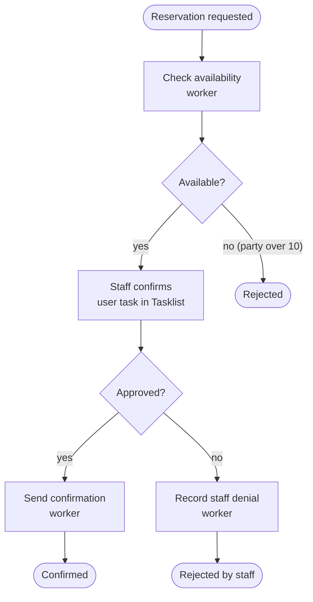

# Camunda 8 Reservation Demo

A small local project to learn [Camunda 8](https://docs.camunda.io/). A guest requests a table in a web form, the request runs through a BPMN process, a staff member approves or declines it in Tasklist, and the web page shows the result live.

It is a learning demo: no database, no web login, no framework. All state lives in Camunda process variables.

## How it works



*Boundary event note:* the diagram omits the **interrupting timer boundary event** on "Staff confirms". A boundary event is attached to an activity and triggers when a condition occurs — here a timer of PT2M. When it fires, it cancels the user task (removing it from Tasklist) and proceeds to a "Record timeout" FEEL script task that sets status="denied" and reason="No staff response within 2 minutes", then ends at "Timed out".

1. The browser form sends the name, date and party size to the Express server.
2. The server starts a Camunda process instance.
3. Workers in the same Node.js process handle the automated steps.
4. Staff complete the **Staff confirms** task in Tasklist, using a Camunda Form.
5. The page polls the server every 2 seconds and shows the status.

## What you need

- Windows with PowerShell
- [Node.js](https://nodejs.org/) 20 or newer
- [Camunda 8 Run 8.10.8](https://downloads.camunda.cloud/release/camunda/c8run/8.10.8/) (includes its own Java, nothing else to install)
- [Camunda Modeler](https://camunda.com/download/modeler/) (optional, only to edit the diagram)

## Run it

**Terminal 1: start Camunda** (in the folder that contains `c8run.exe`):

```powershell
.\c8run.exe start
```

Wait until <http://localhost:8080/operate> loads. Login: `demo` / `demo`.

**Terminal 2: start the app** (in this project folder):

```powershell
npm install
npm start
```

Open <http://localhost:3000>.

`npm start` deploys the process and form, starts the workers, and serves the page.

| Page                          | URL                            |
| ----------------------------- | ------------------------------ |
| Reservation form              | http://localhost:3000          |
| Operate (watch instances)     | http://localhost:8080/operate  |
| Tasklist (staff approve here) | http://localhost:8080/tasklist |

To stop: press `Ctrl+C` in terminal 2, then run `.\c8run.exe stop` in the Camunda folder.

## Try it

| Party size | What happens                                                                                                |
| ---------- | ----------------------------------------------------------------------------------------------------------- |
| 4          | Waits in Tasklist. Approve it and it is confirmed. Decline it with a reason and the page shows that reason. |
| 4          | Leave the task untouched and after 2 minutes it is denied: "No staff response within 2 minutes". The Staff review step is marked as timed out. |
| 12         | Denied immediately: "Party size exceeds the maximum of 10".                                                 |

*Tip for experimenting:* to shorten the timer, edit the `<bpmn:timeDuration>` in `reservation.bpmn` (change `PT2M` to `PT20S` for 20 seconds) and run `npm run deploy`.

## Project files

| File                  | Purpose                                                         |
| --------------------- | --------------------------------------------------------------- |
| `reservation.bpmn`    | The process model                                               |
| `staff-decision.form` | The form staff fill in Tasklist                                 |
| `server.js`           | Express server, API endpoints and the three workers             |
| `camunda.js`          | Camunda client and deployment helper                            |
| `deploy.js`           | Deploys the process without starting the app (`npm run deploy`) |
| `public/index.html`   | The reservation page                                            |

The three workers handle the job types `check-availability`, `send-confirmation`, `record-staff-denial` and `record-timeout`.

## Troubleshooting

| Problem                              | Fix                                                                                                       |
| ------------------------------------ | --------------------------------------------------------------------------------------------------------- |
| `c8run.exe is not recognized`        | You are in the wrong folder. `cd` to the Camunda folder first.                                            |
| `port 8080 is already in use`        | Camunda is already running. Skip the start step.                                                          |
| `npm start` says `fetch failed`      | Camunda is not ready. Check <http://localhost:8080/v2/topology> and retry.                                |
| No task in Tasklist                  | Check Operate. The task must be a native user task (`zeebe:userTask`), and party size must be 10 or less. |
| Changed the BPMN but nothing changed | Run `npm run deploy`, then start a new reservation. Old instances keep their old version.                 |

## Drawing the process

Step-by-step guide to drawing the BPMN diagram and form in Camunda Modeler: [docs/drawing-the-process.md](docs/drawing-the-process.md)

## Learn more

- [Camunda 8 Run](https://docs.camunda.io/docs/self-managed/quickstart/developer-quickstart/c8run/install-start/)
- [Camunda documentation](https://docs.camunda.io/)
